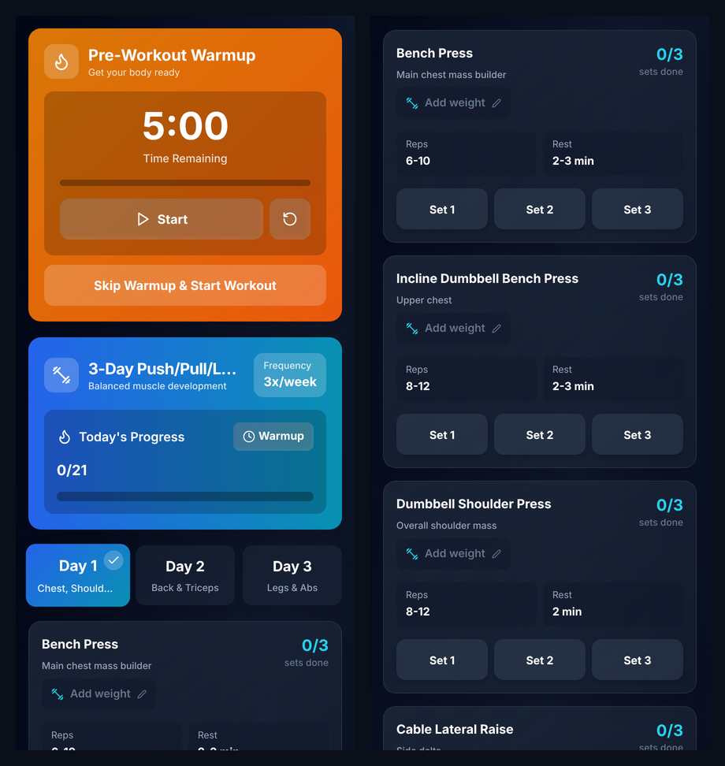

<div align="center">

# 🏋️ 3-Day Push / Pull / Legs Workout Tracker

**A mobile-first gym companion web app: follow the program, tick off sets, log weights and let the rest timer run.**

[](https://minyyyyyyyy.github.io/)




</div>

---

## ✨ Features

- **5-minute warmup timer** with start, pause and reset, or skip straight to the workout
- **Three training days** with a target muscle note for every exercise
  - **Day 1:** Chest, Shoulders, Biceps
  - **Day 2:** Back & Triceps
  - **Day 3:** Legs & Abs
- **Set tracking:** tap *Set 1 / 2 / 3* to mark sets done, with a live "Today's Progress" bar
- **Automatic rest timer** that starts after each completed set, using that exercise's rest period (90 s to 3 min)
- **Weight log:** tap *Add weight* to record the load you used for each exercise
- **Saves your progress:** weights, completed sets and the selected day are stored in `localStorage`, so a page refresh mid-workout loses nothing
- **Reset workout** to start the next session fresh

## 🗓️ The program

| Day 1: Chest, Shoulders, Biceps | Day 2: Back & Triceps | Day 3: Legs & Abs |
|---|---|---|
| Bench Press · 3×6–10 | Cable Lat Pulldown (Wide) · 3×8–12 | Smith Machine Squat · 3×6–10 |
| Incline DB Bench Press · 3×8–12 | Cable Seated Row · 3×8–12 | Smith Machine RDL · 3×8–12 |
| DB Shoulder Press · 3×8–12 | Cable Lat Pullover · 3×10–12 | DB Bulgarian Split Squat · 2×10–12/side |
| Cable Lateral Raise · 3×12–15 | Smith Machine Shrugs · 2×12–15 | DB Stiff-Leg Deadlift · 2×10–12 |
| Cable Rear Delt Fly · 3×15–20 | Cable Tricep Pushdown · 3×10–15 | Smith Machine Calf Raise · 3×12–15 |
| Cable Bicep Curl · 3×8–12 | Overhead Cable Tricep Ext. · 3×12–15 | Cable Ab Crunch · 3×15–20 |
| DB Hammer Curl · 3×10–15 | | Hanging Leg Raises · 2×12–15 |

To change the program, edit the `workouts` object at the top of [`src/WorkoutProgram.jsx`](src/WorkoutProgram.jsx).

## 🚀 Run locally

```bash
git clone https://github.com/minudakaliyanage/Minyyyyyyyy.github.io.git
cd Minyyyyyyyy.github.io
npm install
npm start          # dev server on http://localhost:3000
```

## 📦 Deploy

The site is served by **GitHub Pages** from the `main` branch. This `source` branch holds the React code.

```bash
npm run deploy     # builds and publishes ./build to the main branch via gh-pages
```

## 📁 Structure

```
src/
├── WorkoutProgram.jsx   # the whole app: program data, timers, set/weight tracking
├── index.js             # React entry point
└── index.css            # Tailwind directives
public/index.html
tailwind.config.js · postcss.config.js
```

---

<div align="center"><sub>Built by <a href="https://github.com/minudakaliyanage">Minudaka Liyanage</a></sub></div>
